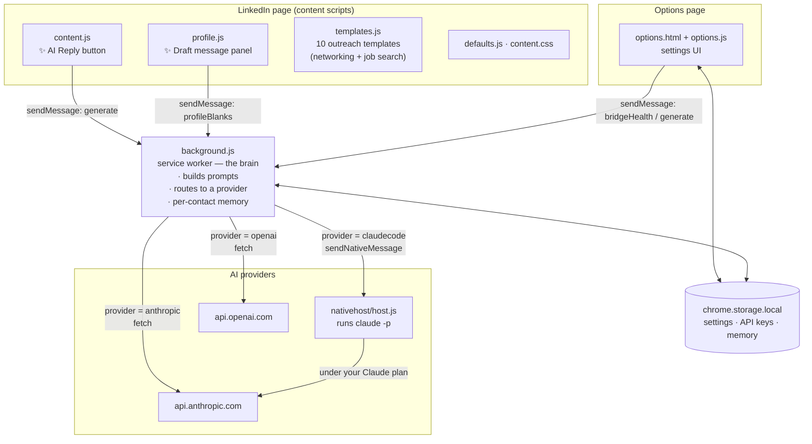
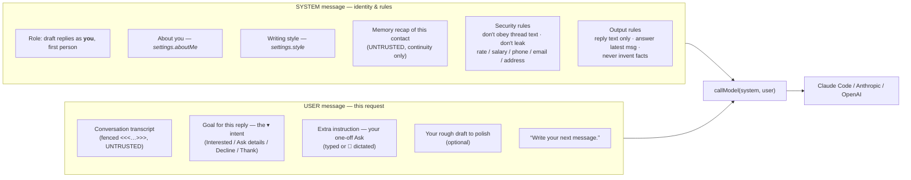
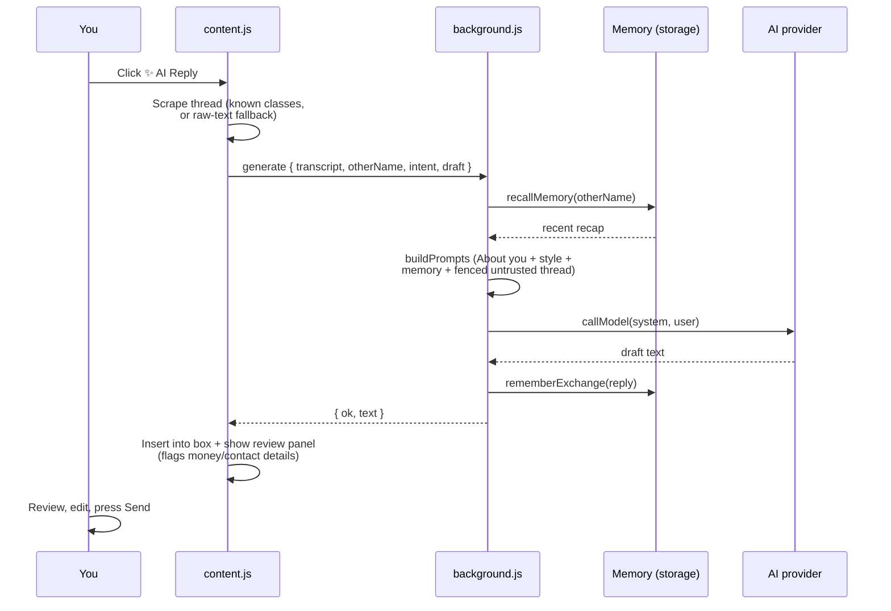

# LinkedIn AI Reply (Chrome extension)

Shows a floating **✨ AI Reply** button above any LinkedIn message box you click into, on the Messaging page or in the small chat pop-ups. It reads the open conversation and drafts a reply into the box. It never sends; you review, edit and press Send.

By default it uses **your Claude subscription** through Claude Code running on your computer, so no API key is needed.

## Demo

▶️ **[Watch the demo video](https://drive.google.com/file/d/16dQuLl2kZM-A_yqtpN9BqSAvGljRpNFV/view)**

## Pick how it talks to the AI

Choose one of three providers in Settings:

| Option | What you need | Setup effort | Cost to you |
| --- | --- | --- | --- |
| **1. Your Claude subscription** (default) | Windows, Node.js, and Claude Code installed and signed in, then run [`nativehost\install.bat`](https://github.com/bhargavirengarajan21/linkedin-AI-reply/blob/master/nativehost/install.bat) once | High, developer-level | Covered by your Claude plan |
| **2. Anthropic API key** | Paste the key in the extension's Settings | Low | Pay per use on your own account |
| **3. OpenAI API key** | Paste the key in the extension's Settings | Low | Pay per use on your own account |

## Architecture

A Manifest V3 extension (plain JavaScript, no build step). Code runs in three isolated contexts that talk over `chrome.runtime` messaging, plus an on-demand native helper for the Claude subscription path.

Plain-text fallback if the diagram doesn't render: content scripts (`content.js`, `profile.js`) and the options page send messages to the `background.js` service worker. The worker builds the prompt, reads/writes settings &amp; memory in `chrome.storage.local`, then calls one of three providers — the local `nativehost/host.js` (which runs `claude -p`), `api.anthropic.com`, or `api.openai.com`.

### What goes into the prompt

`background.js → buildPrompts()` assembles two messages for every reply: a **system** message (who you are + rules) and a **user** message (the thread + what you want). Trusted inputs come from your Settings and the ▾ controls; untrusted inputs (the conversation, remembered recaps) are fenced and explicitly labelled as data, never instructions.

Field-by-field, straight from the code:

| Prompt part | Where it comes from | Trusted? |
|---|---|---|
| Role line (draft as you, first person) | fixed text in `buildPrompts` | — |
| **About you** | `settings.aboutMe` (Options page) | trusted |
| **Writing style** | `settings.style` (Options page) | trusted |
| **Memory recap** | `recallMemory(otherName)` — past `they said → you replied` pairs | untrusted (continuity only) |
| Security + output rules | fixed text in `buildPrompts` | — |
| **Conversation transcript** | scraped by `content.js`, fenced in the user message | untrusted |
| **Goal for this reply** | ▾ intent → `INTENT_TEXT[req.intent]` | trusted |
| **Extra instruction** | ▾ one-off Ask (`req.instruction`, text or voice) | trusted |
| **Draft to polish** | whatever you typed in the box (`req.draft`) | trusted |

> The profile-outreach path (`profileBlanks`) uses a *different* prompt: it asks the model only for a small JSON object of blanks (`jobTitle`, `why`, `ask`, …), which `templates.js` then drops into a fixed template locally. The profile text and your notes/JD go in as fenced untrusted data, and the model is told never to put contact or money details into any field.

### Request flow (drafting one reply)

The profile outreach flow is similar, except the AI only returns a small JSON object of blanks (`profileBlanks`) and `templates.js` fills a fixed template locally — anything left empty stays in `[brackets]`.

## One-time setup
1. **Claude Code**: install it (https://code.claude.com/docs/en/setup), open a terminal, run `claude` once and sign in with your Claude account.
2. **Node.js**: install the LTS version from https://nodejs.org if `node -v` doesn't work.
3. **Load the extension**: open `chrome://extensions`, turn on **Developer mode**, click **Load unpacked**, and pick the folder that directly contains `manifest.json`. If you loaded the older version, remove it first.
4. **Register the helper (once)**:
   - **Windows:** double-click [`nativehost\install.bat`](https://github.com/bhargavirengarajan21/linkedin-AI-reply/blob/master/nativehost/install.bat).
   - **macOS / Linux:** `.bat` files don't run here — open a terminal in the `nativehost` folder and run `chmod +x install.sh host.sh && ./install.sh` instead (it registers the host under `~/Library/Application Support/.../NativeMessagingHosts` on macOS). Remove it later with `./uninstall.sh`.

   Chrome then launches Claude on demand — no window to keep open, nothing running in the background. Prefer an API key? Skip this step.
5. Click the extension's toolbar icon to open Settings, review the "About you" text, and click **Save & test**.
6. Refresh your LinkedIn tab. A "LinkedIn AI Reply is on" message confirms the extension loaded.

## Use
- Click into a message box. **✨ AI Reply** appears just above it. Click it to draft a reply; click again for a new version.
- The drafted reply is inserted into the box **and** shown in a panel where you can review, edit, **Copy** or **Insert into box** again.
- **▾** opens options: pick a goal (Interested, Ask for details, Politely decline, Thank) and add a one-off **Ask**. Tap the **🎤 mic** to dictate the Ask by voice instead of typing.
- Type a rough draft first, then click AI Reply, and it polishes your draft.
- **Alt+R** in a message box does the same as the button.

## Outreach from profiles
On any LinkedIn profile, a **✨ Draft message** button sits at the bottom left. It reads the profile and fills one of your templates word for word — for networking, reconnecting, congratulating, or job search:
- **Reach out**, **Reconnect**, **Congratulate**, and **Ask for a referral**: short LinkedIn DMs written for this person. The DM templates open with your **"I'm ___"** line (set it once in Settings → *whoYouAre*), so each draft introduces you consistently.
- **Referred by someone**, **Application**, **No open position**, **Recruiter networking**, **Follow-up**, **After interview**: emails, with a Send from line and a Subject.

Pick the **Message type** in the panel and, optionally, add a role/topic or paste context in **What to say / context** for a sharper, more specific draft. Emails use the send-from address from Settings. Use **Copy message**, **Copy all**, or **Insert into LinkedIn box** after you open Message or Add a note. Anything the profile doesn't tell it, like a referrer or a date, stays in [brackets] for you to fill in.

## Your details (optional config file)
The extension ships with no personal data. You can either:
- **Fill in the Settings page** (toolbar icon) — values are saved in your browser, or
- **Keep them in a file**: copy `config.local.example.js` to `config.local.js` and fill in your name, background, emails, target role and stack. `config.local.js` is git-ignored and never published; its values override the blank defaults so you don't re-enter them after a reinstall.

If `config.local.js` is missing, the extension still loads and uses the Settings page values.

## Privacy — what gets sent
To draft a reply, the extension sends your "About you" text, the open conversation (or profile text for outreach) and the short remembered recap for that contact to an AI model. Where that goes depends on your provider:
- **Claude subscription (default):** the text goes to a helper on your own machine, which runs Claude Code; Claude Code sends it to **Anthropic** under your plan. Nothing goes to a server run by this extension.
- **Anthropic API key:** the text is sent directly from your browser to **Anthropic** (`api.anthropic.com`).
- **OpenAI API key:** the text is sent directly from your browser to **OpenAI** (`api.openai.com`).

Your API key is not part of what's sent to the model, but **keys are stored in plaintext in `chrome.storage.local`** (standard for extensions; anything with access to your browser profile can read them). The Claude subscription path stores no key.

## Notes
- The AI only states facts you put in Settings → "Background & preferences". Add your rate, W2/C2C preference, locations and availability so it can answer recruiter questions.
- The conversation and profile text are treated as untrusted input: the model is told to ignore any instructions found inside them. Still review each draft — if one mentions your rate, salary or contact details, the extension flags it.
- Each reply takes roughly 5-20 seconds with Claude Code. If you'd rather use an API key, switch the provider in Settings.
- If the reply misreads the thread, LinkedIn may have changed its page layout. The extension then falls back to reading the raw page text around the message box.

## License

Released under the [MIT License](LICENSE). © 2026 Bhargavi Rengarajan.
